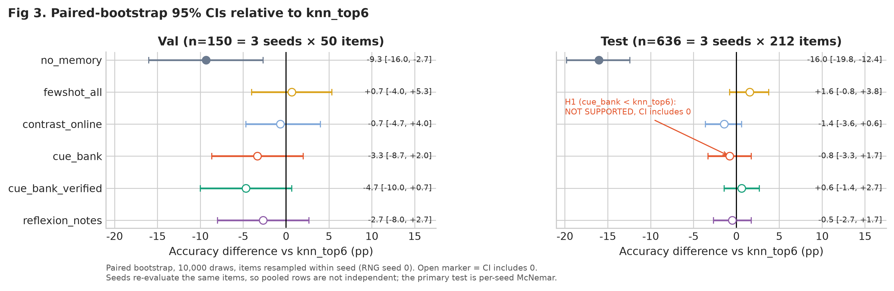

# Project101: 메모리를 활용하는 에이전트 평가

[English documentation](README.md) · [연구 발표 자료](https://harness-midterm-talk.vercel.app) · [분석 그림 갤러리](analysis/figures/README.md)

**연구 질문.** 언어 모델을 고정한 채 프롬프트에 넣는 기억(하네스)만 바꾸면 정확도가
달라지는가? 모델이 생성한 진단 단서가 과거 예시의 단순 검색보다 나은가?

**요약 답.** 검색 기억은 기억 없음보다 분명히 낫습니다. 예시 6개만 골라 넣는 검색은
전체 예시를 넣는 방식과 구별되지 않으면서 입력 토큰은 약 1/5입니다. 생성 단서는
검색보다 낫지 않았고, 50문항 validation에서 보인 검색 우위는 212문항 test에서
재현되지 않았습니다.

개인 파일럿 연구입니다. Symptom2Disease(22개 라벨), 동결 Qwen3.8-Flash-Next-NVFP4,
reasoning 비활성, 시드 3개로 실험했습니다. 질병 예측은 벤치마크 라벨 분류이며
임상 진단이 아닙니다.

## 핵심 결과



| 결과 | 근거 (test 분할, 시드당 n=212, seed 42/123/456) |
|---|---|
| 검색 기억은 기억 없음보다 낫다 | `knn_top6` 83.0% 대 `no_memory` 67.0% (3-seed 평균). 쌍체 부트스트랩 차이 −16.0%p, 95% CI [−19.8, −12.4]. seed 42 정확 McNemar p = 5.6e-6, Holm p = 3.3e-5 |
| 예시 6개 검색이 전체 예시와 구별되지 않는다 | `fewshot_all` 84.6% 대 `knn_top6` 83.0%: +1.6%p, CI [−0.8, +3.8], pooled Mantel-Haenszel p = 0.18. `knn_top6`의 입력 토큰은 80.8% 적음 |
| 생성 단서는 검색보다 낫지 않다 | `cue_bank` −0.8%p, CI [−3.3, +1.7]. `cue_bank_verified` +0.6, CI [−1.4, +2.7]. `reflexion_notes` −0.5, CI [−2.7, +1.7] |
| 소표본 차이는 재현되지 않았다 | validation(n=50): `knn_top6` 41/50 대 `cue_bank` 35/50, p = 0.070. test: 175/212 대 172/212, p = 0.68 |
| 단서 오답은 단서를 따라간다 | 정답 라벨이 단서에 있던 `cue_bank` 오답 45건 중 34건(76%)이 단서에 나온 다른 질병을 예측 |
| temperature 0에서도 모델은 결정적이지 않다 | 같은 호출을 반복하면 validation 문항의 12-14%에서 예측 라벨이, 6-8%에서 정오가 바뀜 |

### 이 결과가 보여 주지 않는 것

- 사전 등록한 주가설의 세 시드 판정은 **INCOMPLETE**입니다. 필요한 결과 37개 중
  29개를 분석했고 seed456 결과 8개가 누락됐습니다.
- 유의하지 않다는 결과로 동등성을 주장할 수 없습니다. 차이 5%p, 불일치율 20%에서
  검정력 80%를 얻으려면 독립 쌍체 문항 약 658개가 필요하며, 이 연구는 212개입니다.
- 세 시드는 같은 212개 test 문장을 다시 평가하므로 636회 평가는 독립 문항 636개가 아닙니다.
- 벤치마크 1개, 동결 모델 1개의 결과이며 임상적 유효성을 주장하지 않습니다.

전체 통계 기록은 아래 [검증된 과거 스냅샷](#검증된-과거-스냅샷)에, 그림별 해석은
[분석 그림 갤러리](analysis/figures/README.md)에 있습니다.

## 검증된 과거 스냅샷

다음은 2026-11-02 02:32 KST에 저장된 로컬 분석 결과입니다.
제외된 입력 없이 새 복제본에서 같은 결과를 재현할 수 있다는 의미는 아닙니다.

| 비교 | 정답 수 | 정확 McNemar p | Holm 보정 p | 해석 |
|---|---|---:|---:|---|
| seed42 test: knn_top6 vs no_memory | 175/212 vs 142/212 | 0.000005550521 | 0.000033303125 | 유의한 보조 비교, +15.57%p |
| seed42 test: knn_top6 vs cue_bank | 175/212 vs 172/212 | 0.6776394844 | 1.0 | 유의한 차이를 발견하지 못함 |
| seed123 test: knn_top6 vs cue_bank | 173/212 vs 179/212 | 0.2101135254 | 0.8404541016 | 유의한 차이를 발견하지 못함, 방향 반대 |
| seed42 validation: knn_top6 vs cue_bank | 41/50 vs 35/50 | 0.0703125 | 0.421875 | 유의한 차이를 발견하지 못함, n=50 |

주가설의 세 시드 판정은 **INCOMPLETE**입니다. 필요한 신규 결과 37개 중
29개를 분석했고 seed456 결과 8개가 누락됐습니다. 무메모리 대비 유의성은
생성 단서에 관한 주가설의 입증이나 Negative Priming의 인과 증명이 아닙니다.
같은 test 문항이 시드마다 반복되므로 636회 평가는 독립 문항 636개가 아닙니다.
유의하지 않다는 결과만으로 동등성을 주장할 수도 없습니다.

저장된 검증에서는 분석·검정력 테스트 26개를 통과했고, 기준 비교 21개와
문항 행 350개가 정확히 일치했습니다. McNemar 기준 CSV도 바이트 단위로
일치했습니다. 사전 등록 문서와 기존 결과·메모리 파일 14개의 해시는 유지됐습니다.
상세 근거는 배포에서 제외된 로컬 `analysis/multiseed/out/validation.json`과
관련 CSV에 보관되어 있습니다.

작업 한도만 DAG 20→60회, 파일 확인 12→21회로 늘렸습니다. 결과를 본 뒤
과학적 파라미터를 조정하지 않았습니다. 향후 독립 실험에서 차이 5%p,
불일치율 20%, 양측 alpha 0.05를 가정하면 검정력 80%에 독립 쌍체 문항
658개가 필요합니다. 이는 가정에 따른 계획이며 유의성을 보장하지 않습니다.

## 캐시 전용 통계 분석

다중 시드 엔진은 모델을 호출하지 않습니다. 기존 실행 파일과 응답 캐시를
재생하며, 캐시가 없으면 응답을 생성하지 않고 결측으로 표시합니다.

- 시드·분할별 정확도와 정확 McNemar 쌍체 검정
- 시드 층화 matched-pair MH 및 합산 불일치 쌍 정확 이항검정
- `knn_top6` 대비 여섯 비교의 Holm 보정
- 시드 내 쌍체 부트스트랩 10,000회, 난수 시드 0
- 등록된 군집 단위에 따른 계열·단서 피처 로지스틱 회귀
- 반복 잡음과 입력 파일 충족률 보고

전체 재생에는 동결 메모리, 결과 파일, 응답 캐시, 기존 기준 출력과 사전 등록
문서가 필요하며 배포본에는 포함하지 않습니다. 과거 캐시 해시에 사용된 내부
주소도 배포 소스에서는 치환하므로, 과거 캐시를 정확히 재생하려면 원래 캐시 키
설정을 로컬에서 복원해야 합니다. 새 복제본의 입력 누락을 실험 결과로 해석하면 안 됩니다.

실험 결과를 읽지 않는 독립 검정력 계산기는 아래처럼 실행할 수 있습니다.

```sh
mkdir -p analysis/multiseed/out
uv run --project harness_lab/text_classification --with scipy \
  python analysis/multiseed/power_plan.py
```

결과는 로컬 `analysis/multiseed/out/`에 저장합니다. 계산의 표본 수는 동일 문항의
반복 평가 횟수가 아니라 독립적인 쌍체 문항 수입니다.

## 테스트

비공개 기준 재생 테스트를 제외한 통계 및 개인정보 검사 실행 명령입니다.

```sh
uv run --project harness_lab/text_classification \
  --with scipy --with statsmodels --with pandas --with pytest \
  python -m pytest analysis/multiseed/test_stats.py \
  analysis/multiseed/test_power_plan.py analysis/multiseed/test_privacy_guard.py \
  -k 'not reference_replay_matches_original_features_and_all_pairs' \
  -q -p no:cacheprovider --basetemp analysis/multiseed/.pytest-tmp
```

재생·일치 검증 중 일부는 비공개 입력이 있어야 통과합니다. CLI 테스트는
stub을 사용하며, 동결 메모리가 필요한 테스트는 메모리가 없으면 건너뜁니다.
분류 데이터 및 데이터 과학 기준 테스트도 제외된 원시 입력이 필요합니다.
전체 테스트를 선택하기 전에 해당 입력의 존재를 확인해야 합니다.

## 구성

| 경로 | 역할 |
|---|---|
| `harness_lab/text_classification/` | 메모리 구현, 온라인 학습과 평가, 벤치마크 실행, 계약 검증 테스트 |
| `harness_cli/` | Typer/Rich 기반 대화형·단건 실행 터미널 인터페이스 |
| `ds_tasks/` | 데이터 과학 기준 파이프라인, 과제 카드, ReAct 실행과 정답 채점 |
| `analysis/harness_stats.py` | 기존 단일 시드 재생, 피처 추출, 통계 진단 |
| `analysis/multiseed/` | 캐시 전용 다중 시드 분석, 쌍체 검정, 부트스트랩, 회귀, 검정력 계획, 개인정보 검사 |

주요 비교 대상은 `no_memory`, `fewshot_all`, `knn_top6`, `contrast_online`,
`reflexion_notes`, `cue_bank`, `cue_bank_verified`입니다.
검색한 원시 예시와 모델이 생성한 단서·노트를 구분합니다. 생성 메모리는
수용된 항목, 검증에서 거절된 항목, 파싱 실패를 나누어 집계합니다.

## 설치와 사전 조건

- Python 3.11 이상과 `uv`가 필요합니다.
- Git을 사용하며, GitHub CLI는 저장소 관리에만 필요합니다.
- 실제 추론에는 별도로 준비한 모델 엔드포인트가 필요합니다.
- 데이터 평가에는 사용이 허가된 로컬 데이터와 동결 메모리가 필요합니다.

저장소 루트에서 필요한 구성 요소만 설치합니다.

```sh
uv sync --project harness_cli --group dev
uv sync --project harness_lab/text_classification
uv sync --project ds_tasks --group dev
```

의존성 설치는 패키지 저장소에 접근할 수 있지만 모델 추론을 시작하지 않습니다.
실험 실행 전에는 자신의 엔드포인트, 데이터 접근 권한과 비용 한도를 설정해야 합니다.

## CLI 사용

`harness_cli` v0.2.2는 평가한 메모리 시스템을 터미널에서 실행하는 도구입니다.
영어로 쓴 자신의 노트에 질문하는 두 번째 작업(study task)도 있습니다.
모델은 고정하고 프롬프트에 넣는 기억(하네스)만 바꿉니다. 8개 블록이 같은
인터페이스를 씁니다. online-v2의 7개 시스템(`no_memory`, `fewshot_all`,
`knn_top6`, `contrast_online`, `cue_bank`, `cue_bank_verified`,
`reflexion_notes`)과 중간과제 후보 `confusion_contrast`입니다. 연구 배경과 전체
결과는 [발표 자료](https://harness-midterm-talk.vercel.app)에 있습니다.

```sh
uv run --project harness_cli harness-cli --help
uv run --project harness_cli harness-cli --demo          # 녹화 응답 재생, 모델 서버 불필요
uv run --project harness_cli harness-cli --demo compare no_memory knn_top6 1
```

실행 환경은 아래 변수로 설정합니다. 실제 키와 내부 주소는 셸 또는
Git에서 제외된 로컬 환경 파일에만 보관합니다.

| 환경 변수 | 의미 |
|---|---|
| `HARNESS_SYSTEM` | 시작 블록 이름 또는 별칭. CLI 기본값은 `confusion_contrast` |
| `HARNESS_MEMORY` | 시작 블록의 내장 기억만 다른 파일로 지정 |
| `HARNESS_DATA_ROOT` | `harness_lab/`(에이전트 코드)이 있는 폴더. 기본값은 저장소 루트 |
| `HARNESS_MODEL` | LiteLLM 형식의 모델 식별자. 없으면 기본값이 아닌 엔드포인트는 `/models` 목록의 첫 모델을 사용 |
| `HARNESS_API_BASE` | 자신이 사용할 OpenAI 호환 엔드포인트 (가장 먼저 시도) |
| `OPENAI_BASE_URL` | 두 번째로 시도할 엔드포인트. vLLM, OpenRouter, Ollama(`http://localhost:11434/v1`) 등 |
| `OPENAI_API_KEY` | 해당 엔드포인트가 요구하는 인증 키 (`/models`와 호출에만 보내고 저장하지 않음) |
| `HARNESS_HOME` | 프로필과 스크래치패드를 저장할 폴더. 기본값 `~/.harness` |

시작할 때 `HARNESS_API_BASE`, `OPENAI_BASE_URL`, 내장 기본 주소, 로컬 Ollama 순서로
`/models`를 확인해 처음 응답한 곳을 씁니다. 실행 중인 모델이 결과를 측정한 모델과 다르면
CLI가 이를 알립니다. 기록된 정확도는 측정한 모델에만 해당합니다.

배포 소스의 내부 기본 주소는 연결되지 않는 `.invalid` 주소로 치환합니다.
자신의 승인된 주소를 설정한 후 아래 명령을 사용합니다.

```sh
# 환경 설정이 끝난 뒤 실행하면 실제 모델 추론을 수행합니다.
uv run --project harness_cli harness-cli
uv run --project harness_cli harness-cli predict "Fever and chills" --json
uv run --project harness_cli harness-cli info
```

대화형 명령:

| 명령 | 동작 |
|---|---|
| `/harness <이름>` (별칭 `/switch`) | 지금 블록 교체. 이름 없이 입력하면 8개 목록 |
| `/compare <블록1> <블록2> [1-3 또는 증상]` | 두 블록을 좌우로 실행해 진단, 프롬프트 크기와 토큰, 응답 시간, 상위 검색 예시, 기록된 test 정확도를 대조 |
| `/record "<증상>" -> "<질병>"` | 세션 기억에 예시 추가 (영어, 22개 라벨 중 하나) |
| `/memory status`, `/memory reset` | 블록별 동결 예시와 세션 추가 예시 표, 세션 추가분 삭제 |
| `/study` | 4단계 학습 가이드: 기억 없음, 예시 선별, 단서 주입, 자유 실험 |
| `/task medical`, `/task study` | 22개 질병 벤치마크와 노트 질의응답 사이 전환 |
| `/load <notes.md\|notes.txt>` | 영어 노트를 제목·문단 단위로 나눠 색인하고 study task로 전환 |
| `/harness no_memory\|knn_retrieval\|lesson_cues` | study task 모드: 질문만, TF-IDF 상위 노트 단락 4개, 가르친 규칙 최대 5개 + 단락 2개 |
| `/record "<개념>" -> "<규칙>"` | study task에서 규칙을 가르침. 다음 질문부터 바로 검색됨 |
| `/inspect context` | 직전 질문의 RAW 프롬프트와 넣은 예시별 TF-IDF 점수, 고른 이유(top-k, 과거 오답, 라벨 coverage) |
| `/explain fewshot` | `fewshot_all`이 확장되지 않는 이유. 기록된 정확도, 질문당 토큰, 계산한 정확도-토큰 파레토 경계 |
| `/profile`, `/profile set <필드> <값>` | 학습자 프로필(`target_exam`, `topics`, `style`, `name`). 노트 기반 프롬프트에 한 줄로 들어감 |
| `/quiz [주제]` | 불러온 노트로 복습 문제 3개와 답 요청 |
| `/help`, `/info`, `/why`, `/clear`, `/exit` | v0.1과 동일 |

기억은 세 계층입니다. 동결 `memory.json`은 읽기만 하며, 동결 로그 안을 가리키는
`HARNESS_HOME`은 거부합니다. `/record`로 추가한 예시와 가르친 규칙은
`~/.harness/scratchpad.json`에 저장되어 `/memory reset` 전까지 다음 세션에도 다시
불러옵니다. `~/.harness/profile.json`에는 학습자 프로필이 있습니다. 불러온 노트는 세션
안에만 있습니다. `--demo`는 `~/.harness`를 읽지도 쓰지도 않으므로 프리셋 재생은 항상
동결 기억을 씁니다. 추가한 예시는 예시를 쓰는 모든 블록의 검색에 들어갑니다.
`cue_bank`, `cue_bank_verified`, `reflexion_notes`에서는 유사 예시 부분만
바뀝니다. 새 단서나 노트를 쓰려면 모델 호출이 필요하기 때문입니다.

`--demo`이거나 서버에 연결할 수 없으면 `replay.json`의 응답을 재생합니다. 이
파일에는 8개 블록 x 프리셋 1-3의 실제 서버 응답이 들어 있습니다. 그 밖의 입력과
`/record`로 기억이 바뀐 뒤의 입력은 오프라인 검색 미리보기를 보여 줍니다. 지금 블록이
보낼 프롬프트 원문, 검색된 예시, 추정 토큰 수를 표시하고 진단은 비어 있습니다
(`predict`는 종료 코드 2). 서버 없이 한 study 질문도 같은 미리보기를 보여 줍니다. 녹화된 프리셋에서는 `no_memory`와 `knn_top6`가 모두 정답이므로 한
건으로는 시스템 간 차이가 드러나지 않습니다. CLI는 비교 화면마다 기록된 평가
결과를 함께 표시합니다. 동결 기억 8개는 패키지 안
(`harness_cli/src/harness_cli/data/memories/`)에 들어 있습니다. 연구 로그와 바이트 단위로
같으며, 로그가 있는 환경에서는 테스트가 이를 확인합니다. 따라서 새로 clone한 컴퓨터에서도
`logs/`나 `HARNESS_DATA_ROOT` 없이 실행됩니다.

새 컴퓨터에서는 엔드포인트를 한 번 지정합니다. 설정은 `~/.harness/config.json`에 저장되며
키는 저장하지 않습니다.

```sh
uv run --project harness_cli harness-cli config --api-base http://localhost:11434/v1 --model llama3.2:3b
OPENAI_API_KEY=... uv run --project harness_cli harness-cli config   # api.openai.com, gpt-4o-mini
```

CLI가 표시하는 수치의 출처는 `analysis/multiseed/out/accuracy_tokens.csv`입니다
(test 분할, seed당 n=212, seed 42/123/456).

| 블록 | test 정확도 (n=212) | 비고 |
|---|---|---|
| `no_memory` | 67.0% | 3-seed 평균, 기준선 |
| `knn_top6` | 83.0% | 3-seed 평균, `fewshot_all` 대비 입력 토큰 80.8% 감소 |
| `fewshot_all` | 84.6% | 3-seed 평균, `knn_top6`와 구분되지 않음 (pooled Mantel-Haenszel p = 0.18, Holm 보정 전) |
| `confusion_contrast` | 80.7% | seed 42 단일 실행 (validation 82.0%, n=50) |

seed 42의 50문항 validation에서 보인 `knn_top6`와 `cue_bank`의 차이(41/50 대 35/50,
p = 0.070)는 212문항 test에서 재현되지 않았습니다(175/212 대 172/212,
p = 0.68). 아래 검증된 과거 스냅샷을 참고하십시오.

### 독립 실행 번들

```sh
cd harness_cli && uv build && cd ..
uv run --project harness_cli python scripts/build_standalone.py
# -> dist/harness-cli-v0.2.2-standalone.zip
```

zip에는 wheel(동결 기억 8개 포함), `harness_lab/text_classification` 실행 코드,
`run.sh`가 들어 있습니다. `run.sh`는 `uv run --with <wheel>`로
`harness-cli --demo`를 실행합니다. `uv`가 필요하고 첫 실행 때 의존성을 PyPI에서
받습니다. 모델 서버는 필요 없습니다. 데이터셋 분할은 포함하지 않습니다.
프롬프트 템플릿은 wheel 안의 사본을 쓰며, 테스트가 데이터셋 프롬프트와 같은지
확인합니다. 내장 기억에는 평가 실행이 기록한 Symptom2Disease 학습 예시가 들어 있습니다.

## 분류 및 데이터 과학 실험

분류 inner loop는 지정된 데이터와 메모리 시스템을 평가하고, benchmark와
meta-harness는 후보 평가와 선택을 관리합니다. 후보 선택에는 validation을
사용하고, test 평가는 선택 및 분석 계획을 고정한 뒤 수행해야 합니다.
내부 `config.yaml`과 원시 JSONL은 배포에서 제외하므로 로컬 설정을 준비해야 합니다.

분류 데이터의 출처는 [`data/README.md`](harness_lab/text_classification/data/README.md)에
기록되어 있습니다. Symptom2Disease 파일은 MCE artifact 배포를 통해 확보했습니다.
배포본에는 원시 증상 문장을 포함하지 않습니다. 이 벤치마크 결과는 임상적
유효성이나 실제 환자 모집단에 대한 전향적 검증을 의미하지 않습니다.

`ds_tasks/`는 이탈 고객·Census 기반 분석의 과제 카드와 결정적 기준 파이프라인을
포함합니다. 원시 파일과 외부 참조 저장소는 제외합니다. 승인된 데이터 경로를
`CHURN_DATA_DIR`로 설정해야 합니다. 실제 에이전트 실행에는 `DS_AGENT_BASE_URL`,
`DS_AGENT_MODEL`과 인증 정보가 추가로 필요합니다. 두 fold를 번갈아 학습과
평가에 사용하는 교차 적합 방식으로 메모리를 평가합니다.

## 범위와 다음 단계

연구 발표 자료는 브라우저에서 바로 보는 HTML 슬라이드입니다.
**[발표 자료 보기](https://harness-midterm-talk.vercel.app)**

이 저장소는 동결된 개인 파일럿 연구입니다. 증상 기반 질병 라벨 분류, 터미널
애플리케이션, 정답 검증이 가능한 데이터 과학 과제, 쌍체 통계 분석을 포함합니다.
GitHub에는 개인정보 검토를 거친 소스 스냅샷을 배포합니다. 원시 데이터, 학습된
메모리, 개인 보고서, 인증 정보, 추론 캐시와 기존 개발 이력은 제외합니다.

재사용을 의도한 부분은 평가 절차입니다. 메모리 계약과 감사, 캐시 전용 재생,
Holm 보정을 포함한 정확 쌍체 검정, 검정력 계획, 시드 3개 미만이면 결론을 쓰지
않는 보고 규칙이 여기에 해당합니다. 에이전트 스터디 팀과의 후속 연구는 별도
저장소에서, 위 검정력 계획에 맞춘 독립 test 세트로 진행할 예정입니다.

## 개인정보와 GitHub 업로드

보고서, 발표 자료, 인증 정보, 원시 데이터, 메모리, 로그, 캐시와 에이전트
세션 상태는 Git에서 제외합니다. 기존 개발 이력은 GitHub 스냅샷에 포함하지 않습니다.
배포 소스의 내부 주소는 연결되지 않는 주소로 치환합니다.

새 복제본에서 로컬 commit/push 보호를 활성화하려면 다음을 실행합니다.

```sh
git config --local core.hooksPath analysis/multiseed/hooks
```

[개인정보 보호 문서](analysis/multiseed/docs/publication_privacy.md)를 참고하세요.
로컬 hook은 우회할 수 있고 정규식 검사는 모든 개인정보를 식별하지 못합니다.
공개 저장소에 push하기 전에 모든 변경을 직접 검토해야 합니다.

## 출처와 라이선스

수정한 Meta-Harness 코드는
[`harness_lab/LICENSE-meta-harness`](harness_lab/LICENSE-meta-harness)의
원본 MIT 고지를 유지합니다. 데이터와 다른 외부 자료에는 각자의 조건이 적용됩니다.
이 문서는 저장소 전체에 새 라이선스를 부여하거나 제외된 데이터의 재배포 권한을
주장하지 않습니다.
