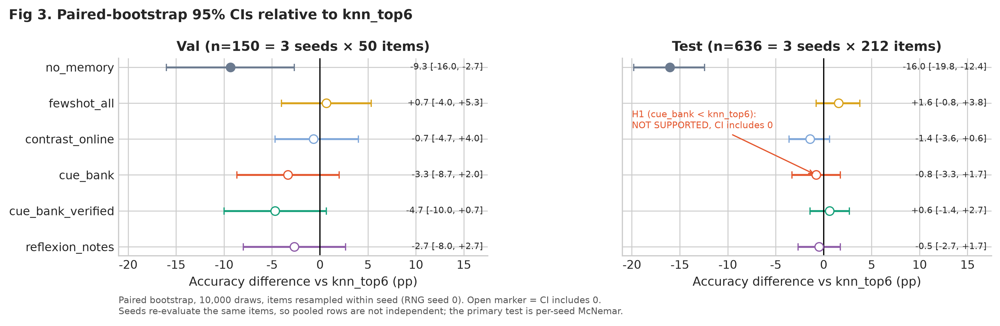
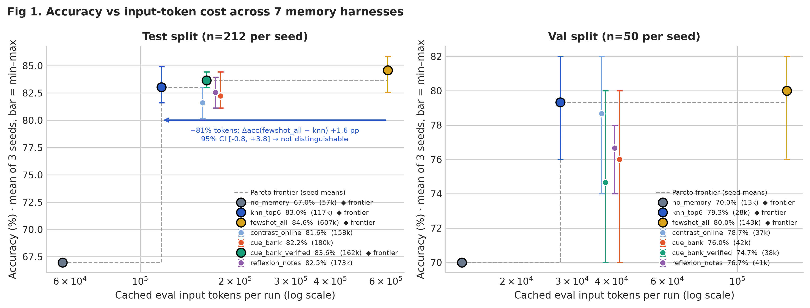
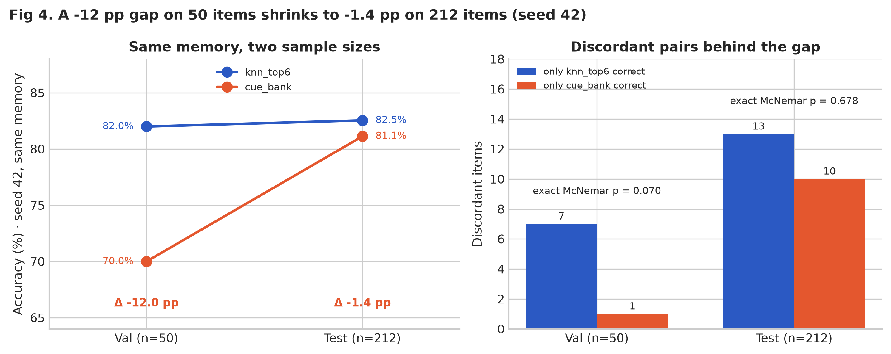
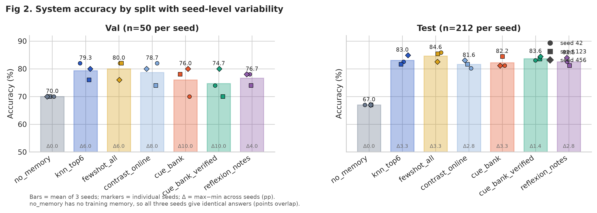
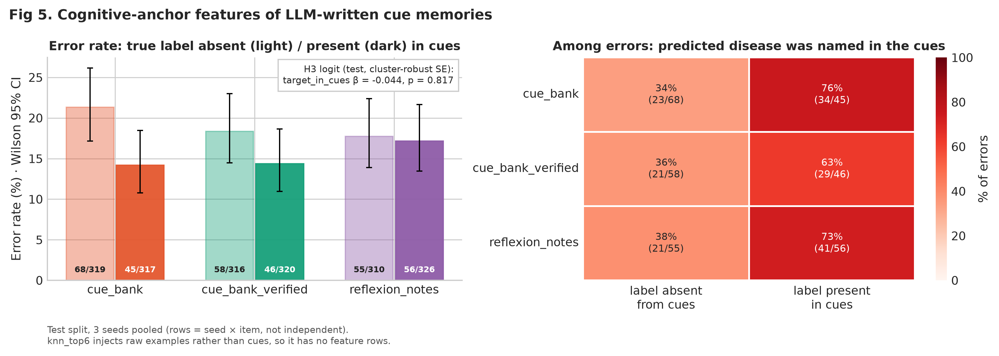
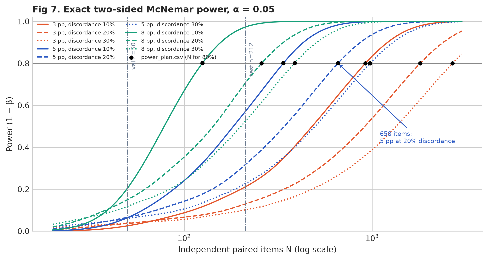
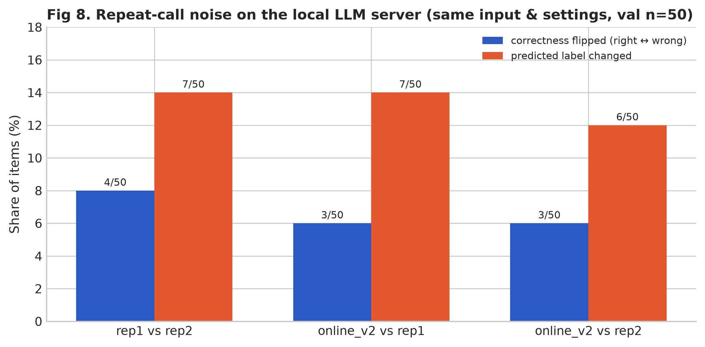
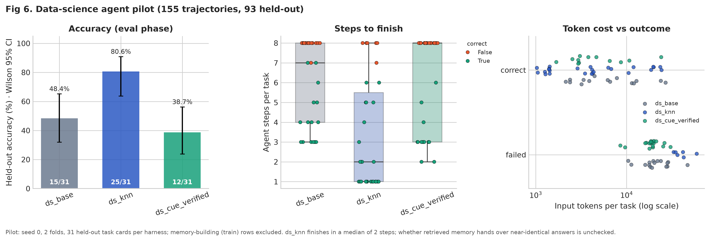

# Project101: Memory-Augmented Agent Evaluation

[](https://harness-midterm-talk.vercel.app)
[](https://www.python.org/)

[**한국어 문서 (Korean)**](README.ko.md) · [**Interactive Slide Deck (Vercel)**](https://harness-midterm-talk.vercel.app) · [**Full Figure Gallery**](analysis/figures/README.md)

> [!IMPORTANT]
> **Positioning — Personal Pilot Study & Interactive Experiment Tool**
>
> **Research Question:** With a language model frozen (`Qwen3.8-Flash-Next-NVFP4`, reasoning disabled), does changing only the prompt memory (*the harness*) improve accuracy, and do LLM-generated diagnostic cues beat plain example retrieval?
>
> **Short Answer:**
> 1. **Retrieval beats no memory** (`knn_top6` **83.0%** vs `no_memory` **67.0%**, paired bootstrap $\Delta = +16.0\text{\%p}$, $p = 5.6 \times 10^{-6}$ on seed 42).
> 2. **Top-6 retrieval matches full 60-shot context at 1/5th the token cost** (`knn_top6` **83.0%** vs `fewshot_all` **84.6%**, $p = 0.18$, **$-80.8\%$ input tokens**).
> 3. **Generated cues did not beat retrieval** (`cue_bank` $-0.8\text{\%p}$, 95% CI $[-3.3, +1.7]$). An apparent $12\text{\%p}$ gap on the 50-item validation split vanished on the 212-item test split ($p = 0.68$).

---

## Quick Navigation

1. [At-a-Glance Summary & Visual Evidence](#1-at-a-glance-summary--visual-evidence)
2. [Why Validation Misled: Small-Sample Illusion vs. Multi-Seed Test](#2-why-validation-misled-small-sample-illusion-vs-multi-seed-test)
3. [Why Generated Cues Failed: Error Patterns & Logistic Regression](#3-why-generated-cues-failed-error-patterns--logistic-regression)
4. [Statistical Rigour: Power Curve, Runtime Noise & Honest Limitations](#4-statistical-rigour-power-curve-runtime-noise--honest-limitations)
5. [Cross-Domain Pilot: Data-Science ReAct Agent (`ds_tasks`)](#5-cross-domain-pilot-data-science-react-agent-ds_tasks)
6. [Interactive CLI (`harness-cli`): Study Assistant & Benchmark Replay](#6-interactive-cli-harness-cli-study-assistant--benchmark-replay)
7. [Repository Architecture, Reproducibility & Privacy](#7-repository-architecture-reproducibility--privacy)

---

## 1. At-a-Glance Summary & Visual Evidence

This pilot evaluates seven memory harnesses on **Symptom2Disease** (22 disease labels, 3 seeds: `42`, `123`, `456`). Disease labels are benchmark text classifications, not clinical diagnoses.

### Visual 1A — Effect Size Against `knn_top6` (Paired Bootstrap 95% CI)



* **How to read:** Zero (dashed vertical line) represents `knn_top6` performance. Only `no_memory` falls clearly outside the confidence interval ($-16.0\text{\%p}$, 95% CI $[-19.8, -12.4]$). All generated-cue systems (`cue_bank`, `cue_bank_verified`, `reflexion_notes`) straddle zero.

### Visual 1B — Accuracy vs. Input Tokens Pareto Frontier



* **How to read:** Injecting all 60 training examples (`fewshot_all`, 607k tokens per test split) yields **84.6%**, whereas retrieving only the 6 closest examples via TF-IDF (`knn_top6`, 117k tokens) yields **83.0%**—cutting input tokens by **80.8%** with no statistically distinguishable drop ($+1.6\text{\%p}$, 95% CI $[-0.8, +3.8]$, pooled Mantel-Haenszel $p = 0.18$).

### Key Findings Table (Test Split, $n = 212$ per seed)

| Core Takeaway | Quantitative Evidence (Seeds 42 / 123 / 456) |
|---|---|
| **1. Retrieval memory beats no memory** | `knn_top6` **83.0%** vs `no_memory` **67.0%** (3-seed mean); paired bootstrap $-16.0\text{\%p}$ $[-19.8, -12.4]$; seed 42 exact McNemar $p = 5.6 \times 10^{-6}$ (Holm $p = 3.3 \times 10^{-5}$) |
| **2. Top-6 retrieval matches 60-shot at 1/5th cost** | `fewshot_all` **84.6%** vs `knn_top6` **83.0%**: $+1.6\text{\%p}$, CI $[-0.8, +3.8]$, MH $p = 0.18$; **`knn_top6` saves 80.8% input tokens** |
| **3. Generated cues do not beat retrieval** | `cue_bank` $-0.8\text{\%p}$ $[-3.3, +1.7]$; `cue_bank_verified` $+0.6\text{\%p}$ $[-1.4, +2.7]$; `reflexion_notes` $-0.5\text{\%p}$ $[-2.7, +1.7]$ |
| **4. Small-sample gap did not replicate** | Seed 42 validation ($n=50$): `knn_top6` 41/50 (82%) vs `cue_bank` 35/50 (70%), $p = 0.070$ $\rightarrow$ Test ($n=212$): 175/212 vs 172/212, $p = 0.68$ |
| **5. Cue errors follow injected cues** | Among `cue_bank` errors where the true disease appeared in the injected cues, **34 / 45 (76%)** predicted another disease named in the cues |
| **6. Temperature 0 is not deterministic** | Repeating identical SGLang FP4 calls flipped predicted labels on **12–14%** of validation items and flipped correctness on **6–8%** |

---

## 2. Why Validation Misled: Small-Sample Illusion vs. Multi-Seed Test

A central methodological lesson of this pilot is how easily a 50-item validation split creates false confidence.

| Validation vs. Test Reproducibility (`Fig 4`) | Split & Seed Variance Across Systems (`Fig 2`) |
|---|---|
|  |  |
| **Left (`Fig 4`):** On seed 42, `cue_bank` trailed `knn_top6` by **$-12.0\text{\%p}$** on validation ($n=50$, discordant pairs 7:1, exact $p=0.070$). On the held-out test split ($n=212$) using the exact same frozen memory, the gap shrank to **$-1.4\text{\%p}$** (discordant pairs 13:10, $p=0.678$). | **Right (`Fig 2`):** Because a single question on $n=50$ shifts accuracy by $2.0\text{\%p}$, validation accuracy varied by up to **10.0%p** across seeds, compared to **3.3%p** on the 212-item test split. |

---

## 3. Why Generated Cues Failed: Error Patterns & Logistic Regression

We audited whether LLM-written diagnostic rules (`cue_bank`, `cue_bank_verified`, `reflexion_notes`) act as misleading anchors when injected into the prompt.



* **Descriptive Error Attraction (Right Heatmap):** When `cue_bank` made an error despite the true disease being mentioned in the injected cues ($45$ cases across test seeds), **76% ($34/45$)** of its wrong answers selected *another disease explicitly named in those cues*.
* **Preregistered Clustered Logistic Regression (Middle Panel, H3):** Controlling for question-clustered standard errors, the indicator `target_in_cues` was **not statistically significant** ($\beta = -0.044, p = 0.817$). Instead, correctness was driven by **lexical similarity to retrieved examples** (`max_similarity` error $\beta = -2.921, p = 0.014$) and **prompt length** (`prompt_kchars` $\beta = -1.488, p = 0.003$). Thus, descriptive cue-following does not prove a causal "negative priming" effect beyond retrieval quality.

---

## 4. Statistical Rigour: Power Curve, Runtime Noise & Honest Limitations

| Exact McNemar Power Curve (`Fig 7`) | Local LLM Serving Stochasticity (`Fig 8`) |
|---|---|
|  |  |
| **Left (`Fig 7`):** At $20\%$ pair discordance and two-sided $\alpha = 0.05$, detecting a $5\text{\%p}$ difference with $80\%$ power requires **$n = 658$ independent paired questions**. At $n = 50$ power is **0.07**; at $n = 212$ power is only **0.32**. | **Right (`Fig 8`):** Re-running identical prompts at `temperature=0` on the FP4 server changed the predicted label on **6–7 / 50 (12–14%)** items and flipped accuracy on **3–4 / 50 (6–8%)** items. Small validation differences fall inside serving noise. |

> [!WARNING]
> ### What These Results Do NOT Show (Explicit Limitations)
> - **Primary 3-Seed Verdict is `INCOMPLETE`:** Only **29 of 37** preregistered result files were analysable (8 `seed 456` files were missing). Under our preregistered rule, no final multi-seed verdict is claimed below 3 complete seeds.
> - **Non-Significance $\neq$ Equivalence:** Failing to reject the null between `knn_top6` and `cue_bank` ($p = 0.68$) does not prove they are equal; $n = 212$ is underpowered for $<5\text{\%p}$ effects.
> - **Repeated Evaluations $\neq$ Independent Sample Size:** Evaluating 212 test items across 3 seeds yields 636 trials, **not** 636 independent questions. Primary tests are conducted per seed.
> - **Single Benchmark & Frozen Model:** Results apply to `Symptom2Disease` on `Qwen3.8-Flash-Next-NVFP4` (zero-think) and carry zero clinical validity.

<details>
<summary><strong>📊 Click to expand: Verified Historical Snapshot Table (Exact McNemar & Holm-Adjusted p-values)</strong></summary>

The table below is the saved local analysis snapshot from `2026-11-02 02:32 KST`.

| Comparison | Correct Predictions | Exact McNemar $p$ | Holm-Adjusted $p$ | Interpretation |
|---|---|---:|---:|---|
| **Seed 42 test:** `knn_top6` vs `no_memory` | 175/212 vs 142/212 | `0.00000555` | `0.0000333` | **Significant** secondary comparison ($+15.57\text{\%p}$) |
| **Seed 42 test:** `knn_top6` vs `cue_bank` | 175/212 vs 172/212 | `0.6776` | `1.0000` | No significant difference found |
| **Seed 123 test:** `knn_top6` vs `cue_bank` | 173/212 vs 179/212 | `0.2101` | `0.8405` | No significant difference; opposite sign |
| **Seed 42 val:** `knn_top6` vs `cue_bank` | 41/50 vs 35/50 | `0.0703` | `0.4219` | Not significant after multiplicity ($n=50$) |

- **Verification audit:** 26 analysis/power unit tests passed; 21 reference comparisons and 350 question rows matched byte-for-byte against original logs.
- **Reproducing the power plan without private logs:**
  ```sh
  mkdir -p analysis/multiseed/out
  uv run --project harness_lab/text_classification --with scipy \
    python analysis/multiseed/power_plan.py
  ```

</details>

---

## 5. Cross-Domain Pilot: Data-Science ReAct Agent (`ds_tasks`)

To test whether the same memory trade-off appears in multi-step tool use, we ran a single-seed pilot on 31 unseen data-science task cards (`eval` split, excluding `train` trajectories).



* **Unseen Evaluation (`eval`, $n = 31$ per harness):**
  * `ds_knn` (retrieved trajectory examples): **80.6%** ($25/31$), median **2 steps**, **4,334** input tokens.
  * `ds_base` (no memory): **48.4%** ($15/31$), median **7 steps**, **16,042** input tokens.
  * `ds_cue_verified` (verified rules): **38.7%** ($12/31$).
* **Caveat:** Because this is a single-seed pilot and we have not yet audited how closely retrieved `train` trajectories mirror `eval` answers, this is reported as an exploratory observation rather than a confirmed conclusion.

---

## 6. Interactive CLI (`harness-cli`): Study Assistant & Benchmark Replay

`harness_cli` v0.2.2 connects the research findings to an interactive terminal tool with **two strictly separated modes**:

| Mode | Purpose | How to Launch |
|---|---|---|
| **1. Practical Study Assistant (`study`, Default)** | Load your own `.md`/`.txt` lecture notes, ask grounded questions via TF-IDF/KNN retrieval, and accumulate persistent rules (`~/.harness`). Zero medical preset clutter on startup. | `uv run --project harness_cli harness-cli` <br> `uv run --project harness_cli harness-cli ask "What is L2 regularization?" --doc notes.md` |
| **2. Capstone Benchmark Lab (`medical`, Isolated)** | Swap all 8 frozen research memory blocks like Lego bricks, inspect exact injected prompts (`/inspect context`), and compare blocks side-by-side (`/compare`). | `uv run --project harness_cli harness-cli --demo compare no_memory knn_top6 1` <br> Or type `/task medical` inside REPL |

### Quickstart (30 Seconds, No GPU Server Needed)

```sh
# 1. Install CLI dependencies
uv sync --project harness_cli --group dev

# 2. Launch default Practical Study Assistant (interactive REPL)
uv run --project harness_cli harness-cli

# 3. Replay frozen Capstone research comparisons offline (--demo)
uv run --project harness_cli harness-cli --demo compare no_memory knn_top6 1
```

<details>
<summary><strong>🛠️ Click to expand: Live LLM Endpoint Configuration, REPL Commands & Standalone Bundle</strong></summary>

#### Configuring a Live Model Endpoint (Ollama / OpenAI / vLLM)
Save your endpoint once in `~/.harness/config.json` (API keys are read from environment variables or `.env`, never written to disk):

```sh
# Local Ollama
uv run --project harness_cli harness-cli config --api-base http://localhost:11434/v1 --model llama3.2:3b

# OpenAI API
OPENAI_API_KEY=... uv run --project harness_cli harness-cli config --api-base https://api.openai.com/v1 --model gpt-4o-mini
```

#### Interactive REPL Slash Commands

| Command | Action |
|---|---|
| `/load <notes.md\|notes.txt>` | Index personal Markdown/text notes by heading & paragraph (`study` mode) |
| `/record "<concept>" -> "<rule>"` | Teach a persistent rule (`study`) or session symptom-disease pair (`medical`) |
| `/harness <name>` (or `/switch`) | Swap active memory strategy (`none`, `knn`, `cues` in study; 8 frozen blocks in medical) |
| `/compare <A> <B> [query/1-3]` | Run two memory strategies side-by-side and compare prompt tokens, picks, and answers |
| `/inspect context` | Inspect the exact raw prompt, retrieved chunks/examples, and TF-IDF similarity scores |
| `/explain fewshot` | Display the logged accuracy-token Pareto frontier and why `fewshot_all` fails to scale |
| `/profile`, `/quiz [topic]` | Customize learner profile (`~/.harness/profile.json`) or generate 3 review questions |
| `/task medical` / `/task study` | Explicitly switch between Personal Study Mode and the 22-Disease Research Lab |

#### Building the Standalone Portable Zip
```sh
cd harness_cli && uv build && cd ..
uv run --project harness_cli python scripts/build_standalone.py
# Produces -> dist/harness-cli-v0.2.2-standalone.zip (includes bundled wheel + 8 frozen memories)
```

</details>

---

## 7. Repository Architecture, Reproducibility & Privacy

| Directory | Role |
|---|---|
| [`analysis/figures/`](analysis/figures/README.md) | 8 publication figures (300 DPI PNG + vector PDF) and automated generation script |
| `analysis/multiseed/` | Cache-only multi-seed statistical engine, exact McNemar, bootstrap, power planner & privacy guard |
| `harness_cli/` | Typer/Rich interactive CLI with Practical Study Mode and 8-block Benchmark Replay |
| `harness_lab/text_classification/` | Memory harness implementations (`no_memory`, `fewshot_all`, `knn_top6`, `cue_bank`, etc.) |
| `ds_tasks/` | Deterministic data-science task cards, ReAct agent loop, and 2-fold cross-fitting evaluator |

### Running Verification Tests (Clean Clone)

```sh
# 1. Run CLI unit & integration test suite
uv run --project harness_cli pytest harness_cli/tests -q

# 2. Run statistical engine, power planner, and privacy guard tests
uv run --project harness_lab/text_classification \
  --with scipy --with statsmodels --with pandas --with pytest \
  python -m pytest analysis/multiseed/test_stats.py \
  analysis/multiseed/test_power_plan.py analysis/multiseed/test_privacy_guard.py \
  -k 'not reference_replay_matches_original_features_and_all_pairs' \
  -q -p no:cacheprovider --basetemp analysis/multiseed/.pytest-tmp
```

### Scope, Privacy & Attribution
- **Next Steps (Team Study):** This repository is a **frozen personal pilot**. The reusable assets are the evaluation contracts, cache-only statistical pipeline, power calculation ($n=658$), and automated privacy guard. Follow-up research with the agent study group will take place in a separate repository.
- **Privacy Guard:** Raw patient texts, personal reports, inference caches, and internal hostnames are excluded. Enable local pre-commit/pre-push hooks in a clone via:
  ```sh
  git config --local core.hooksPath analysis/multiseed/hooks
  ```
- **Attribution:** Adapted Meta-Harness code retains its upstream MIT notice in [`harness_lab/LICENSE-meta-harness`](harness_lab/LICENSE-meta-harness). Upstream datasets carry their own respective terms.
