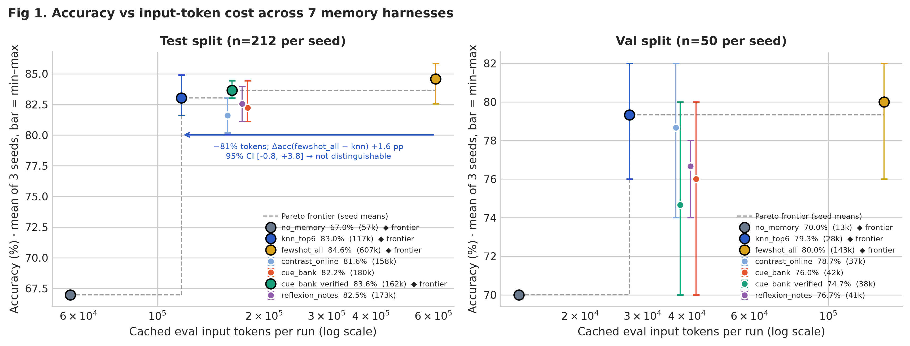
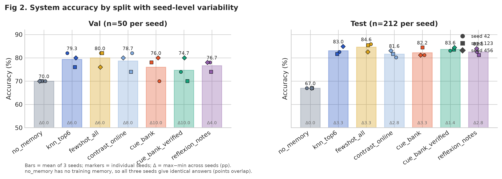
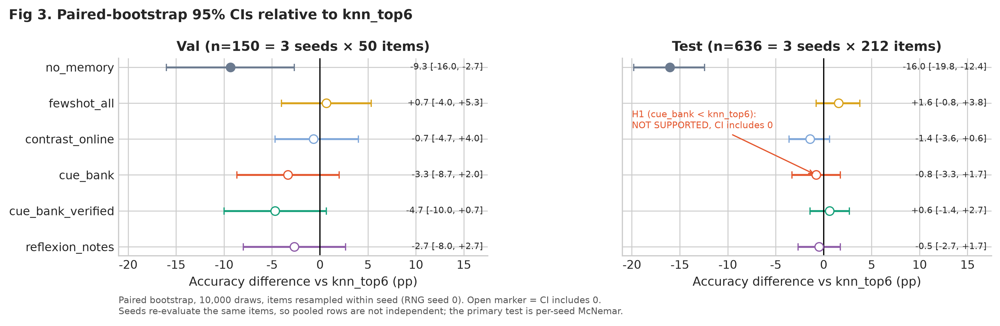
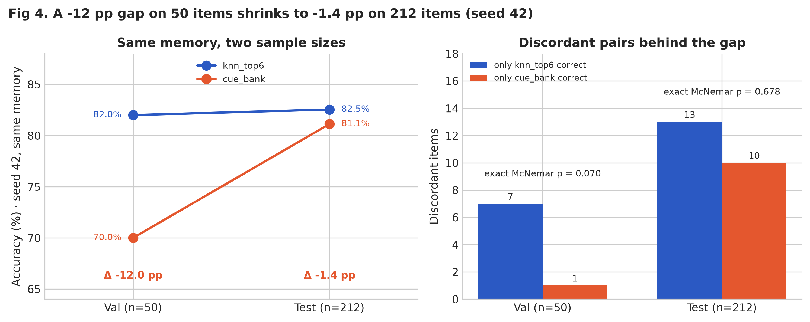
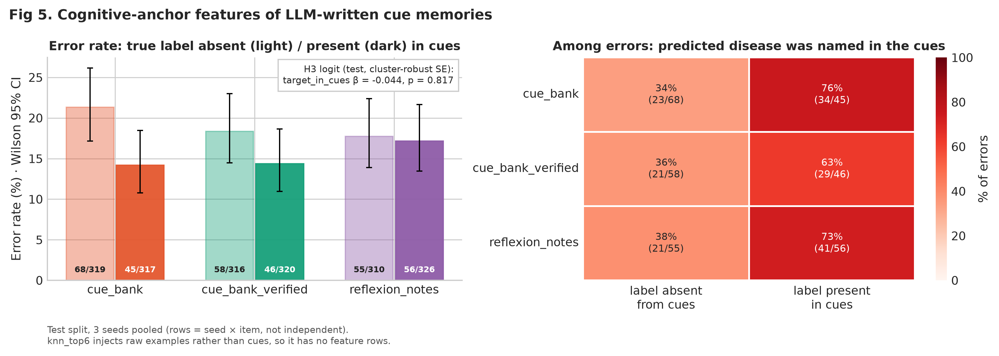
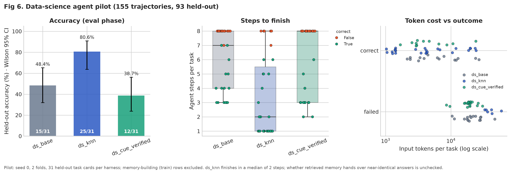
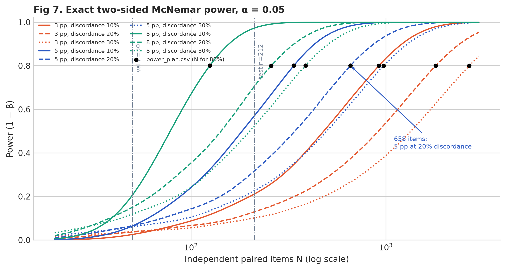
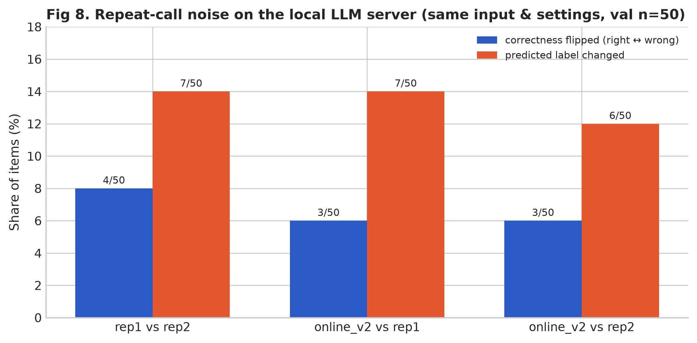

# 분석 그림 갤러리

- 생성: 2026-11-02 03:46 KST. `analysis/generate_visualizations.py`가 그림 8종과 이 문서를 함께 만듭니다.
- 원천: `analysis/multiseed/out/*.csv`, `logit_h3.txt`, `ds_tasks/runs/pilot-s0/trajectories.parquet`
- 본문 숫자는 모두 위 파일에서 실행 시점에 계산했습니다. 각 그림은 PNG(300 dpi)와 PDF(벡터)로 저장됩니다.

```bash
uv run --project harness_lab/text_classification \
  --with matplotlib --with seaborn --with pandas --with pyarrow --with scipy \
  python analysis/generate_visualizations.py
```

## Fig 1. 정확도와 입력 토큰의 파레토 관계



- test에서 knn_top6는 평균 116,673 토큰으로 83.0%, fewshot_all은 607,449 토큰으로 84.6%입니다. knn_top6의 입력 토큰이 81% 적습니다.
- 정확도 차이(fewshot_all − knn_top6)는 +1.6%p, 95% CI [-0.8, +3.8]입니다. 0을 포함하므로 "같다"가 아니라 "이 규모로는 구별되지 않는다"로 읽어야 합니다.
- test 파레토 경계(시드 평균 기준)는 no_memory → knn_top6 → cue_bank_verified → fewshot_all입니다. 경계 위 점들 사이의 정확도 차이는 모두 Fig 3의 CI 안에 있어, 경계의 순서 자체도 이 표본 규모에서는 확정적이지 않습니다.

## Fig 2. 분할별 성능과 시드 변동



- 시드 간 최대−최소 폭은 val에서 최대 10.0%p, test에서 최대 3.3%p입니다. 50문항에서는 한 문항이 2%p라 폭이 커집니다.
- no_memory는 학습 기억이 없어 세 시드의 답이 같습니다(점 세 개가 겹침).

## Fig 3. knn_top6 대비 페어드 부트스트랩 95% CI



- 사전 등록 주 가설 H1(cue_bank < knn_top6)의 test 차이는 -0.8%p, CI [-3.3, +1.7]로 0을 포함합니다. 판정은 NOT SUPPORTED이며, 효과가 없다는 증명은 아닙니다.
- CI가 0에서 떨어진 시스템은 no_memory뿐입니다: test -16.0%p [-19.8, -12.4]. fewshot_all은 +1.6%p [-0.8, +3.8]입니다.
- 부트스트랩은 시드 안에서 문항을 재표집했습니다. 세 시드는 같은 212문항을 다시 평가한 것이라 n=636을 독립 표본으로 볼 수 없고, 주 검정은 시드별 McNemar입니다.

## Fig 4. 소표본과 대표본의 재현성



- seed 42의 같은 기억으로 cue_bank − knn_top6는 val(50문항)에서 -12.0%p, test(212문항)에서 -1.4%p였습니다.
- 불일치 문항은 val 7:1 (exact p=0.070), test 13:10 (p=0.678)입니다. val의 큰 격차도 불일치 8문항에서 나온 값이고 5% 수준에서 유의하지 않았습니다.

## Fig 5. 단서 기억의 인지적 닻 피처



- 대상은 LLM이 쓴 단서를 주입하는 세 시스템(cue_bank, cue_bank_verified, reflexion_notes)의 test 행입니다. knn_top6는 원시 예시를 넣으므로 피처 행이 없습니다.
- 정답 질환이 단서에 있을 때 vs 없을 때 오답 수: cue_bank 45/317 vs 68/319; cue_bank_verified 46/320 vs 58/316; reflexion_notes 56/326 vs 55/310.
- 사전 등록 H3 로짓(문항 군집 강건 표준오차)에서 target_in_cues 계수는 -0.044 (p=0.817)로 효과가 보이지 않습니다. 유의했던 항은 max_similarity -2.921 (p=0.014)와 prompt_kchars -1.488 (p=0.003)입니다.
- 오른쪽 히트맵은 오답 중 예측 질환이 단서에 나온 질환이었던 비율입니다. 단서가 오답을 끌어당기는 양상을 서술적으로 보여 줄 뿐 인과 효과의 근거는 아닙니다.

## Fig 6. 데이터사이언스 에이전트 파일럿



- 궤적 155건 중 기억을 만드는 train 단계를 빼고, 처음 보는 과제(eval, 하네스당 31건)만 그렸습니다.
- eval 정확도: ds_base 15/31 = 48.4%, ds_knn 25/31 = 80.6%, ds_cue_verified 12/31 = 38.7%.
- 요청서의 74.2%(ds_knn)와 46.8%(ds_cue_verified)는 train과 eval을 합친 값(ds_knn 46/62, ds_cue_verified 29/62)이라, eval 31건만 있는 ds_base와 분모가 다릅니다. 처음 보는 과제의 성능 비교에는 eval 값을 씁니다.
- ds_knn의 eval 중앙 스텝은 2, 중앙 입력 토큰은 4,334입니다(ds_base 7스텝, 16,042토큰). 검색된 기억이 거의 같은 답을 넘겨주는지는 확인하지 않았습니다.
- 시드 1개 파일럿이므로 하네스 간 차이를 결론으로 쓰지 않습니다.

## Fig 7. 통계적 검정력 곡선



- `analysis/multiseed/power_plan.py`의 정확 McNemar 검정력 함수로 곡선을 그렸습니다. 검은 점은 `power_plan.csv`의 80% 달성 표본 수이고, 스크립트가 5%p·불일치 20% → 658을 재확인합니다.
- 불일치율 20%에서 5%p 효과의 검정력은 n=50에서 0.07, n=212에서 0.32입니다. 8%p 효과도 n=212에서 0.71입니다.
- 이번 test 212문항은 5%p 안팎의 차이를 가려내도록 설계된 규모가 아닙니다. 확인 실험에는 독립 문항 수백 개 단위가 필요합니다.

## Fig 8. 로컬 LLM 서빙의 반복 호출 잡음



- 같은 입력·같은 설정으로 다시 돌린 세 쌍(val 50문항)에서 정오가 바뀐 문항은 4/50, 3/50, 3/50 (6~8%), 예측 라벨이 바뀐 문항은 7/50, 7/50, 6/50 (12~14%)입니다.
- 50문항에서 몇 문항 차이는 이 잡음 범위 안에서 읽어야 합니다. 서버 쪽의 정확한 원인은 확인하지 못했습니다.
